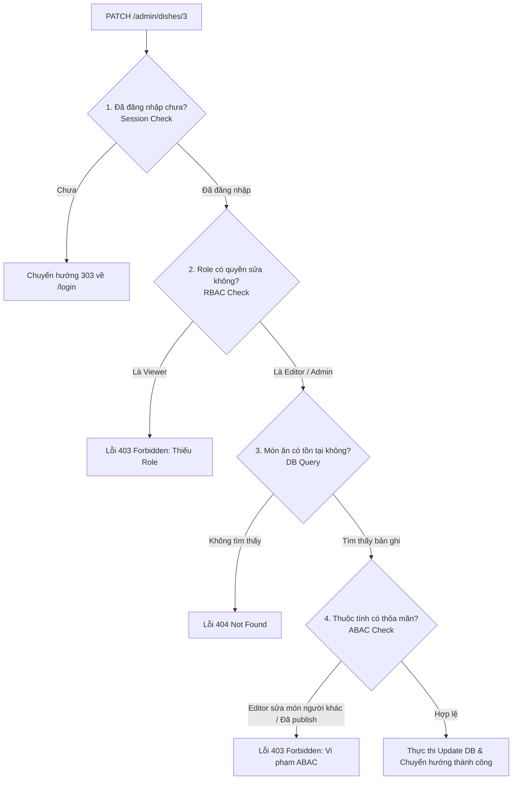

# BỘ CÂU HỎI & TRẢ LỜI VẤN ĐÁP KỸ THUẬT: BÀI 1 (MFA VÀ PHÂN QUYỀN CHO BẢN SSR)

> **Tài liệu tham khảo nghiệp vụ & kiến trúc:**  
> - Slide môn học *Phát triển ứng dụng web* - MSc. Ngô Ngọc Đăng Khoa: [Block 9 Deck](https://pub.nndkhoa9.win/web/week7/block9-deck.html) & [Block 8 Deck](https://pub.nndkhoa9.win/web/week6/block8-deck.html).  
> - Tiêu chuẩn quốc tế: RFC 6238 (TOTP), RFC 4226 (HOTP), OWASP MFA Cheat Sheet, OWASP Access Control Cheat Sheet.

---

## MỤC LỤC TỔNG QUAN

- [PHẦN I: THUẬT TOÁN, MÃ HÓA VÀ AN TOÀN MẬT MÃ (CRYPTO & ALGORITHMS)](#phần-i-thuật-toán-mã-hóa-và-an-toàn-mật-mã)
  - [Câu 1: Thuật toán băm mật khẩu tài khoản](#câu-1-thuật-toán-băm-mật-khẩu-tài-khoản)
  - [Câu 2: Thuật toán sinh mã TOTP (RFC 6238)](#câu-2-thuật-toán-sinh-mã-totp-rfc-6238)
  - [Câu 3: Khóa bí mật mfaSecret (Base32)](#câu-3-khóa-bí-mật-mfasecret-base32)
  - [Câu 4: Thuật toán xử lý dung sai lệch giờ (Time Skew Tolerance)](#câu-4-thuật-toán-xử-lý-dung-sai-lệch-giờ-time-skew-tolerance)
  - [Câu 5: Cơ chế chống tấn công phát lại (Replay Attack)](#câu-5-cơ-chế-chống-tấn-công-phát-lại-replay-attack)
  - [Câu 6: Thuật toán sinh và lưu trữ Recovery Codes](#câu-6-thuật-toán-sinh-và-lưu-trữ-recovery-codes)
  - [Câu 7: Thuật toán chống Brute-Force mã OTP](#câu-7-thuật-toán-chống-brute-force-mã-otp)
  - [Câu 8: Điểm yếu của TOTP trước Phishing thời gian thực](#câu-8-điểm-yếu-của-totp-trước-phishing-thời-gian-thực)
- [PHẦN II: THIẾT KẾ CƠ SỞ DỮ LIỆU & QUẢN LÝ PHIÊN (DATABASE & SESSION)](#phần-ii-thiết-kế-cơ-sở-dữ-liệu--quản-lý-phiên)
  - [Câu 9: Bổ sung Database Schema cho Bài 1](#câu-9-bổ-sung-database-schema-cho-bài-1)
  - [Câu 10: Lưu trữ và khôi phục Session sau khi Restart Server](#câu-10-lưu-trữ-và-khôi-phục-session-sau-khi-restart-server)
  - [Câu 11: Thuộc tính an toàn của Session Cookie](#câu-11-thuộc-tính-an-toàn-của-session-cookie)
  - [Câu 12: Trạng thái chờ MFA (mfaPending) và vùng cách ly phiên](#câu-12-trạng-thái-chờ-mfa-mfapending-và-vùng-cách-ly-phiên)
  - [Câu 13: Chống cố định phiên (Session Fixation Attack)](#câu-13-chống-cố-định-phiên-session-fixation-attack)
- [PHẦN III: PHÂN QUYỀN RBAC VÀ ABAC (ROLE & ATTRIBUTE-BASED ACCESS CONTROL)](#phần-iii-phân-quyền-rbac-và-abac)
  - [Câu 14: Phân biệt RBAC và ABAC, tại sao phải kết hợp](#câu-14-phân-biệt-rbac-và-abac-tại-sao-phải-kết-hợp)
  - [Câu 15: Ma trận phân quyền chi tiết giữa Viewer, Editor và Admin](#câu-15-ma-trận-phân-quyền-chi-tiết-giữa-viewer-editor-và-admin)
  - [Câu 16: Chuỗi kiểm tra quyền nghiêm ngặt tại Server (Guard Order)](#câu-16-chuỗi-kiểm-tra-quyền-nghiêm-ngặt-tại-server-guard-order)
  - [Câu 17: Tại sao kiểm tra lúc GET mở form là chưa đủ?](#câu-17-tại-sao-kiểm-tra-lúc-get-mở-form-là-chưa-đủ)
  - [Câu 18: Đối phó hành vi giả mạo dữ liệu trong Form / Hidden Inputs](#câu-18-đối-phó-hành-vi-giả-mạo-dữ-liệu-trong-form--hidden-inputs)
  - [Câu 19: Ẩn nút trên UI có giá trị bảo mật không?](#câu-19-ẩn-nút-trên-ui-có-giá-trị-bảo-mật-không)
- [PHẦN IV: VÒNG ĐỜI NGHIỆP VỤ & TÌNH HUỐNG BIÊN (WORKFLOWS & EDGE CASES)](#phần-iv-vòng-đời-nghiệp-vụ--tình-huống-biên)
  - [Câu 20: Vòng đời kích hoạt MFA (Setup Lifecycle)](#câu-20-vòng-đời-kích-hoạt-mfa-setup-lifecycle)
  - [Câu 21: Quy trình đăng nhập cứu hộ bằng Recovery Code](#câu-21-quy-trình-đăng-nhập-cứu-hộ-bằng-recovery-code)
  - [Câu 22: Nguyên tắc Re-Authentication khi thay đổi/tắt MFA](#câu-22-nguyên-tắc-re-authentication-khi-thay-đổitắt-mfa)
  - [Câu 23: Quên mật khẩu (Reset Password) có được tự tắt MFA không?](#câu-23-quên-mật-khẩu-reset-password-có-được-tự-tắt-mfa-không)
  - [Câu 24: Bảng tổng hợp các mã phản hồi HTTP trong SSR (303, 401, 403, 404, 429)](#câu-24-bảng-tổng-hợp-các-mã-phản-hồi-http-trong-ssr)

---

# PHẦN I: THUẬT TOÁN, MÃ HÓA VÀ AN TOÀN MẬT MÃ

### Câu 1: Thuật toán băm mật khẩu tài khoản
**Hỏi:** *Trong hệ thống, bạn dùng thuật toán nào để băm (hash) mật khẩu của người dùng? Tại sao không dùng MD5, SHA-1 hay SHA-256 thuần?*

**Trả lời:**
1. **Thuật toán sử dụng:** **`Argon2id`** (đạt chuẩn chiến thắng cuộc thi quốc tế *Password Hashing Competition - PHC*), hoặc **`bcrypt`** (với work factor $\ge 12$).
2. **Cấu hình tham số chuẩn an ninh cho Argon2id:**
   - `type`: `argon2id` (kết hợp khả năng chống tấn công kênh bên Side-channel của Argon2i và chống tấn công vét cạn bộ nhớ Time-Memory Trade-off của Argon2d).
   - `memoryCost`: `65536` KB ($64\text{ MB RAM}$).
   - `timeCost`: `3` rounds (vòng lặp thời gian).
   - `parallelism`: `1` luồng.
3. **Tại sao tuyệt đối không dùng MD5, SHA-1, SHA-256 thuần?**
   - Các hàm băm họ SHA/MD5 là các **hàm băm thông điệp tốc độ cao (Fast Hash Functions)**, được thiết kế để kiểm tra toàn vẹn file nhanh nhất có thể (hàng tỷ phép tính mỗi giây trên card đồ họa GPU hoặc chip ASIC chuyên dụng). Nếu kẻ tấn công đánh cắp cơ sở dữ liệu, chúng có thể dùng Rainbow Tables hoặc vét cạn hàng tỷ mật khẩu trong vài phút.
   - Các thuật toán chuyên dụng như Argon2id/bcrypt là các **hàm kéo dài khóa có chi phí bộ nhớ & thời gian (Memory-hard & CPU-intensive)**, cố tình làm chậm quá trình tính toán để triệt tiêu năng lực giải mã của siêu máy tính/ASIC.

---

### Câu 2: Thuật toán sinh mã TOTP (RFC 6238)
**Hỏi:** *Bạn dùng thuật toán nào để sinh mã TOTP cho MFA? Công thức toán học và cơ chế băm là gì? Tại sao hai bên (App điện thoại và Server) không cần gửi tin nhắn SMS hay Email mà vẫn đồng bộ mã 6 số?*

**Trả lời:**
1. **Thuật toán sử dụng:** **TOTP (Time-based One-Time Password)** theo tiêu chuẩn **RFC 6238** (kế thừa từ thuật toán HOTP - RFC 4226).
2. **Bản chất đồng bộ không qua mạng:**
   - Không có mã OTP nào được truyền trên mạng lúc sinh mã.
   - Cả hai bên đều sở hữu chung một chuỗi bí mật (**`Secret`**) chia sẻ từ trước (lúc quét mã QR).
   - Yếu tố thay đổi duy nhất là **thời gian Unix hiện tại ($t$)** mà cả điện thoại và server đều tự đọc được từ đồng hồ hệ thống.
3. **Công thức toán học 4 bước:**
   - **Bước 1 (Tính Time Step $T$):**  
     $$T = \left\lfloor \frac{t - T_0}{X} \right\rfloor = \left\lfloor \frac{\text{Unix Time (giây)}}{30} \right\rfloor$$  
     Mặc định khung thời gian $X = 30\text{ giây}$. Mọi thời điểm trong cùng 30 giây sẽ cho ra cùng một số nguyên $T$.
   - **Bước 2 (Tính HMAC):**  
     $$\text{HS} = \text{HMAC-SHA1}(K, T) \quad (\text{với } K \text{ là Shared Secret đã giải mã từ Base32})$$
   - **Bước 3 (Rút gọn động - Dynamic Truncation):**  
     Lấy byte cuối cùng của kết quả băm $\text{HS}[19]$ và trích xuất 4 bit thấp để làm vị trí dịch `offset`:  
     $$\text{offset} = \text{HS}[19] \ \& \ \text{0x0F}$$  
     Trích xuất 4 byte bắt đầu từ `offset`, bỏ bit dấu:  
     $$\text{BinaryCode} = (\text{HS}[\text{offset}] \& \text{0x7F}) \ll 24 \mid (\text{HS}[\text{offset}+1] \& \text{0xFF}) \ll 16 \mid \dots$$
   - **Bước 4 (Tạo mã 6 số):**  
     $$\text{Mã OTP} = \text{BinaryCode} \pmod{10^6}$$  
     Nếu mã nhỏ hơn 6 chữ số, đệm số `0` ở đầu (ví dụ: `48291` $\rightarrow$ `"048291"`).

---

### Câu 3: Khóa bí mật mfaSecret (Base32)
**Hỏi:** *Khóa bí mật `mfaSecret` được sinh bằng cách nào, độ dài bao nhiêu byte, tại sao phải mã hóa Base32 và lưu trữ ở đâu trong DB?*

**Trả lời:**
1. **Cách sinh:** Sử dụng bộ sinh số ngẫu nhiên giả an toàn mật mã (CSPRNG):  
   `crypto.randomBytes(20)` (160 bits entropy, đạt chuẩn khuyến nghị của RFC 6238).
2. **Tại sao dùng Base32?**
   - Chuỗi nhị phân ngẫu nhiên được mã hóa sang bảng chữ cái **Base32** (chỉ chứa các ký tự `A-Z` và `2-7`, loại bỏ các ký tự dễ gây nhầm lẫn thị giác như số `0`/chữ `O`, số `1`/chữ `l`/chữ `I`).
   - Định dạng URI quét mã QR:  
     `otpauth://totp/RestaurantApp:user@example.com?secret=JBSWY3DPEHPK3PXP&issuer=RestaurantApp&algorithm=SHA1&digits=6&period=30`
3. **Lưu trữ:**
   - Lưu tại cột `mfaSecret` trong bảng `User` (hoặc bảng phụ `MfaSetting`).
   - Khuyến nghị an ninh cao: Mã hóa đối xứng chuỗi `mfaSecret` (dùng AES-256-GCM với Master Key lưu ngoài môi trường `process.env.ENCRYPTION_KEY`) trước khi ghi vào Database để phòng ngừa lộ secret khi database bị rò rỉ.

---

### Câu 4: Thuật toán xử lý dung sai lệch giờ (Time Skew Tolerance)
**Hỏi:** *Đồng hồ giữa điện thoại người dùng và server có thể bị lệch vài giây hoặc mạng bị trễ. Bạn xử lý dung sai thời gian như thế nào? Cửa sổ time step là bao nhiêu?*

**Trả lời:**
1. **Cơ chế xử lý (Window Skew):**
   - Server tính toán mã OTP hợp lệ tại bước thời gian hiện tại ($T_0$).
   - Đồng thời, server tính thêm mã ở **1 bước lùi ($T_{-1}$)** và **1 bước tiến ($T_{+1}$)**:
     - $T_0$: $[t - 30\text{s} \dots t]$
     - $T_{-1}$: $[t - 60\text{s} \dots t - 30\text{s}]$ (phòng ngừa đồng hồ điện thoại chậm hơn server)
     - $T_{+1}$: $[t + 30\text{s} \dots t + 60\text{s}]$ (phòng ngừa đồng hồ điện thoại nhanh hơn server)
   - Nếu mã người dùng nhập khớp với bất kỳ bước nào trong $\{T_{-1}, T_0, T_{+1}\}$, server chấp nhận là hợp lệ.
2. **Quy tắc an ninh:** Tuyệt đối không mở rộng cửa sổ ra $T_{\pm 2}$ hay $T_{\pm 3}$ vì sẽ làm tăng thời gian hiệu lực của mã lên hàng phút, tạo cơ hội cho kẻ tấn công brute-force hoặc nghe lén.

---

### Câu 5: Cơ chế chống tấn công phát lại (Replay Attack)
**Hỏi:** *Vì một mã TOTP có hiệu lực trong 30 giây, nếu kẻ gian chặn bắt được mã trên đường truyền, chúng có thể gửi lại mã đó trước khi hết 30 giây để đăng nhập không? Làm sao chống phát lại?*

**Trả lời:**
1. **Nguy cơ Replay Attack:**  
   Nếu người dùng đăng nhập ở giây thứ 5, thì trong 25 giây còn lại của khung $T_0$, mã OTP vẫn là mã toán học hợp lệ nếu chỉ kiểm tra bằng thuật toán TOTP thuần túy.
2. **Giải pháp triển khai (Trường `lastUsedTimeStep`):**
   - Trong bảng `User` (hoặc bảng theo dõi MFA), tạo thêm trường:  
     `lastUsedTimeStep BigInt DEFAULT 0`
   - Khi người dùng gửi mã OTP lên:
     - Giả sử mã khớp với bước thời gian $T_{\text{match}} \in \{T_{-1}, T_0, T_{+1}\}$.
     - Server kiểm tra điều kiện:
       $$\text{Nếu } T_{\text{match}} \le \text{user.lastUsedTimeStep} \implies \text{TỪ CHỐI (Mã đã được sử dụng)}$$
     - Nếu $T_{\text{match}} > \text{user.lastUsedTimeStep}$: Chấp nhận đăng nhập và cập nhật ngay lập tức:  
       $$\text{user.lastUsedTimeStep} \leftarrow T_{\text{match}}$$
3. **Kết quả:** Trong cùng một bước thời gian 30 giây, một mã chỉ có thể đăng nhập thành công **đúng 1 lần duy nhất**. Mọi request gửi lại sau đó đều bị chặn đứng.

---

### Câu 6: Thuật toán sinh và lưu trữ Recovery Codes
**Hỏi:** *Mã khôi phục (Recovery Codes) được sinh bằng thuật toán nào? Tại sao tuyệt đối không được lưu chuỗi gốc (plaintext) vào cơ sở dữ liệu?*

**Trả lời:**
1. **Thuật toán sinh:**
   - Sinh bộ 8 đến 10 mã ngẫu nhiên bằng CSPRNG:  
     `crypto.randomBytes(5).toString("hex")` (tạo chuỗi 10 ký tự, ví dụ: `a4f8-9e12-3c`).
   - Bộ mã này **chỉ được hiển thị duy nhất một lần** trên giao diện lúc người dùng hoàn tất kích hoạt MFA để họ in ra hoặc sao lưu vào nơi an toàn.
2. **Lưu trữ chuẩn an ninh (Hash-at-Rest):**
   - **Tuyệt đối không lưu chuỗi gốc:** Nếu kẻ tấn công có quyền đọc cơ sở dữ liệu (SQL Injection hoặc lộ backup DB), việc lưu plaintext sẽ làm sụp đổ hoàn toàn hàng rào MFA.
   - **Cơ chế:** Server băm từng mã khôi phục bằng hàm băm một chiều an toàn (Argon2id, bcrypt hoặc SHA-256 có Salt/Pepper) và lưu vào bảng `RecoveryCode`:  
     `{ id, userId, codeHash, usedAt: null }`
3. **Quy tắc sử dụng:**
   - Mỗi mã chỉ được sử dụng một lần: Khi đối chiếu thành công, server lập tức ghi nhận `usedAt = new Date()`.
   - Các lần đăng nhập sau, truy vấn luôn lọc `WHERE usedAt IS NULL`.

---

### Câu 7: Thuật toán chống Brute-Force mã OTP
**Hỏi:** *Mã TOTP chỉ có 6 chữ số (từ 000000 đến 999999, tức 1 triệu khả năng). Làm sao hệ thống ngăn chặn kẻ tấn công chạy tool tự động vét cạn mã?*

**Trả lời:**
Hệ thống triển khai cơ chế kiểm soát thử sai đa tầng (Rate Limiting & Lockout Policy):
1. **Giới hạn số lần thử (Attempt Counter):**
   - Phiên chờ MFA (`mfaPending`) hoặc bản ghi User lưu biến `mfaAttempts`.
   - Mỗi lần nhập sai mã OTP: `mfaAttempts = mfaAttempts + 1`.
2. **Ngưỡng khóa tạm thời (Temporary Lockout):**
   - Nếu `mfaAttempts >= 5` lần liên tiếp:
     - Khóa chức năng xác thực MFA trong vòng **5 phút** (`mfaLockedUntil = now() + 5 phút`).
     - Hủy luôn phiên đăng nhập tạm thời, buộc người dùng phải bắt đầu lại từ bước nhập email/mật khẩu.
3. **Phân biệt Rate Limit theo IP và Tài khoản:**
   - Theo IP: Ngăn chặn 1 IP thử vét cạn nhiều tài khoản (Ví dụ: tối đa 30 requests/phút).
   - Theo Tài khoản: Dù kẻ tấn công dùng Botnet đổi hàng ngàn IP, tài khoản nạn nhân vẫn bị khóa tạm thời sau 5 lần thử sai.

---

### Câu 8: Điểm yếu của TOTP trước Phishing thời gian thực
**Hỏi:** *Lỗ hổng lớn nhất của mã TOTP 6 số là gì? Tại sao các hệ thống tài chính cao cấp đang chuyển dần sang FIDO2/WebAuthn/Passkeys?*

**Trả lời:**
1. **Lỗ hổng Phishing thời gian thực (Real-time Reverse Proxy / Adversary-in-the-Middle):**
   - Kẻ tấn công dựng trang web giả mạo có giao diện giống hệt trang thật (sử dụng các bộ công cụ như *Evilginx*).
   - Khi nạn nhân truy cập trang giả, họ nhập email, password và mã OTP 6 số.
   - Máy chủ của kẻ tấn công lập tức chuyển tiếp (proxy) các thông tin đó về máy chủ thật ngay trong khung 30 giây.
   - Máy chủ thật xác nhận mã OTP hợp lệ và cấp phiên đăng nhập cho kẻ tấn công $\rightarrow$ **TOTP bị vô hiệu hóa hoàn toàn trước Phishing tinh vi.**
2. **Giải pháp triệt để hơn (FIDO2 / WebAuthn):**
   - Sử dụng mật mã khóa công khai (Asymmetric Cryptography) gắn chặt với tên miền (**Origin Binding**). Trình duyệt chỉ gửi chữ ký điện tử cho đúng tên miền thật, máy chủ giả mạo không thể lấy được bất kỳ credential nào.

---

# PHẦN II: THIẾT KẾ CƠ SỞ DỮ LIỆU & QUẢN LÝ PHIÊN

### Câu 9: Bổ sung Database Schema cho Bài 1
**Hỏi:** *Để hiện thực đầy đủ Phân quyền RBAC, ABAC và MFA cho ứng dụng Nhà hàng theo yêu cầu Bài 1, Schema cơ sở dữ liệu cần thay đổi những gì?*

**Trả lời:**
Cần bổ sung/điều chỉnh các thực thể trong Schema (sử dụng Prisma ORM làm ví dụ chuẩn):

```prisma
// 1. Cập nhật Model User
model User {
  id                Int       @id @default(autoincrement())
  email             String    @unique
  passwordHash      String
  role              String    @default("viewer") // "viewer", "editor", "admin"
  chefId            Int?      // Khóa ngoại liên kết đầu bếp (dành cho editor)
  chef              Chef?     @relation(fields: [chefId], references: [id])
  
  // Các trường phục vụ MFA
  mfaEnabled        Boolean   @default(false)
  mfaSecret         String?   // Base32 secret string (khuyến nghị mã hóa)
  lastUsedTimeStep  BigInt?   // Chống Replay Attack
  mfaAttempts       Int       @default(0)
  mfaLockedUntil    DateTime?
  
  recoveryCodes     RecoveryCode[]
  sessions          Session[]
}

// 2. Bổ sung Model RecoveryCode
model RecoveryCode {
  id        Int       @id @default(autoincrement())
  userId    Int
  user      User      @relation(fields: [userId], references: [id], onDelete: Cascade)
  codeHash  String    // Băm SHA-256 hoặc Argon2id của mã khôi phục
  usedAt    DateTime? // NULL = chưa dùng; có giá trị = đã sử dụng
  createdAt DateTime  @default(now())

  @@index([userId])
}

// 3. Cập nhật Model Dish (Món ăn phục vụ ABAC)
model Dish {
  id          Int       @id @default(autoincrement())
  name        String
  price       Int
  category    String
  chefId      Int       // Đầu bếp chịu trách nhiệm món ăn
  chef        Chef      @relation(fields: [chefId], references: [id])
  status      String    @default("draft") // "draft" (nháp) hoặc "published" (công bố)
  available   Boolean   @default(true)
}
```

---

### Câu 10: Lưu trữ và khôi phục Session sau khi Restart Server
**Hỏi:** *Trong ứng dụng SSR, Session được lưu ở đâu? Khi restart lại server Node.js, tại sao người dùng không bị văng đăng nhập (Session restoration)?*

**Trả lời:**
1. **Nơi lưu Session thực tế:**
   - **Tuyệt đối không lưu trong bộ nhớ RAM (`MemoryStore`)** của tiến trình Node.js: Lưu trong RAM sẽ gây rò rỉ bộ nhớ, mất toàn bộ phiên khi restart, và không thể chạy nhiều tiến trình (clustering/load balancing).
   - **Persistent Store:** Lưu trữ vào bảng `Session` trong cơ sở dữ liệu SQL (SQLite/PostgreSQL qua Prisma Session Store) hoặc bảng phân tán **Redis** (dùng `connect-redis`).
2. **Cấu trúc bản ghi Session:**
   - `sid`: Khóa chính (Primary Key), chuỗi ngẫu nhiên có độ dài lớn.
   - `userId`: Liên kết tới người dùng đăng nhập.
   - `data`: Chuỗi JSON chứa trạng thái phiên (`{ userId: 1, role: 'admin', mfaVerified: true }`).
   - `expiresAt`: Mốc thời gian hết hạn của phiên.
3. **Cơ chế khôi phục khi Restart:**
   - Trình duyệt lưu mã định danh `sid` trong Cookie.
   - Khi server khởi động lại, Database/Redis vẫn giữ nguyên các bản ghi session còn hạn (`expiresAt > now()`).
   - Khi request kế tiếp gửi tới mang cookie `sid`, Middleware đọc `sid`, query từ Database/Redis, nạp lại dữ liệu người dùng vào `req.user` $\implies$ Phiên đăng nhập vẫn duy trì trơn tru.

---

### Câu 11: Thuộc tính an toàn của Session Cookie
**Hỏi:** *Cookie mang mã phiên `sid` phải được cấu hình những cờ (flags) bảo mật nào? Nêu rõ tác dụng phòng thủ của từng cờ?*

**Trả lời:**

| Thuộc tính (Flag) | Giá trị cấu hình | Tác dụng phòng vệ an ninh |
| :--- | :--- | :--- |
| **`HttpOnly`** | `true` | **Chống XSS đánh cắp Session:** Tuyệt đối cấm mã JavaScript trên trình duyệt truy cập vào cookie qua `document.cookie`. Dù web có lỗ hổng XSS, kẻ tấn công cũng không đọc được `sid`. |
| **`Secure`** | `true` (môi trường Production) | **Chống nghe lén (Sniffing):** Trình duyệt chỉ gửi cookie qua giao thức được mã hóa HTTPS, không bao giờ gửi qua HTTP thường. |
| **`SameSite`** | `'Lax'` hoặc `'Strict'` | **Chống tấn công CSRF (Cross-Site Request Forgery):** Ngăn chặn trình duyệt tự động gửi kèm cookie khi request xuất phát từ một tên miền khác. |
| **`Max-Age` / `Expires`** | Ví dụ: `7200` (2 giờ) | Xác định vòng đời tối đa của cookie, tránh việc cookie tồn tại vô thời hạn trên máy dùng chung. |
| **`Path`** | `/` | Đảm bảo cookie có hiệu lực trên toàn bộ phạm vi ứng dụng. |

---

### Câu 12: Trạng thái chờ MFA (mfaPending) và vùng cách ly phiên
**Hỏi:** *Khi người dùng nhập đúng Email và Mật khẩu nhưng tài khoản đã bật MFA, Server cấp phiên như thế nào? Tại sao phải có vùng cách ly phiên `mfaPending`?*

**Trả lời:**
1. **Luồng phân tách trạng thái:**
   - Sau khi password đúng: Server **chưa cấp quyền truy cập**.
   - Server chỉ lưu vào session cờ tạm:  
     `req.session.mfaPending = true;`  
     `req.session.partialUserId = user.id;`  
     *(Tuyệt đối chưa gán `req.session.user` hoặc nạp quyền vào phiên).*
2. **Vùng cách ly phiên ở Middleware `requireLogin`:**
   ```javascript
   function requireLogin(req, res, next) {
     // Nếu chưa có session hoặc đang kẹt ở bước chờ MFA -> CHẶN
     if (!req.session.userId || req.session.mfaPending) {
       return res.redirect(303, "/login");
     }
     next();
   }
   ```
3. **Ý nghĩa an ninh:**
   - Ngăn chặn triệt để lỗ hổng bỏ qua bước 2: Nếu không cách ly, kẻ tấn công biết mật khẩu có thể mở thẳng URL `/admin/dishes` để thao tác mà không cần nhập OTP.
   - **Chỉ có duy nhất** route xử lý kiểm tra mã OTP (`POST /login/mfa`) là chấp nhận phiên mang cờ `mfaPending`.

---

### Câu 13: Chống cố định phiên (Session Fixation Attack)
**Hỏi:** *Tại sao sau khi người dùng nhập đúng mã TOTP (hoặc Recovery Code), server bắt buộc phải tái tạo Session ID (`req.session.regenerate`)?*

**Trả lời:**
1. **Nguy cơ Tấn công cố định phiên (Session Fixation):**
   - Kẻ tấn công có thể gài sẵn một Session ID (`sid`) chưa xác thực vào trình duyệt của nạn nhân (qua link độc hoặc XSS).
   - Nếu sau khi nạn nhân hoàn tất đăng nhập/MFA mà server vẫn giữ nguyên `sid` cũ đó và nâng cấp quyền, kẻ tấn công có thể dùng `sid` đã biết từ trước để truy cập tài khoản của nạn nhân.
2. **Biện pháp phòng ngừa:**
   - Ngay khi mã OTP hợp lệ, server gọi hàm tạo mới Session:
   ```javascript
   req.session.regenerate((err) => {
     req.session.userId = user.id;
     req.session.role = user.role;
     req.session.mfaPending = false; // Xóa cờ chờ
     req.session.save(() => res.redirect(303, "/admin"));
   });
   ```
   - Trình duyệt sẽ được cấp một cookie `sid` hoàn toàn mới và ngẫu nhiên; `sid` cũ bị tiêu hủy lập tức.

---

# PHẦN III: PHÂN QUYỀN RBAC VÀ ABAC

### Câu 14: Phân biệt RBAC và ABAC, tại sao phải kết hợp
**Hỏi:** *Phân biệt RBAC và ABAC? Nêu một trường hợp cụ thể trong bài mà RBAC thuần túy chịu bó tay và bắt buộc phải dùng ABAC?*

**Trả lời:**
1. **Định nghĩa:**
   - **RBAC (Role-Based Access Control):** Quyết định dựa trên **Vai trò (Role)** của người dùng (`Viewer`, `Editor`, `Admin`). Trả lời câu hỏi: *"User này có quyền sửa món ăn nói chung không?"*
   - **ABAC (Attribute-Based Access Control):** Quyết định dựa trên **Thuộc tính** của Người thao tác (Subject), Hành động (Action), Bản ghi dữ liệu (Resource), và Môi trường (Environment). Trả lời câu hỏi: *"User này có quyền sửa **món ăn cụ thể này** vào **thời điểm này** không?"*
2. **Trường hợp RBAC chịu bó tay:**
   - Giả sử có hai đầu bếp cùng là `Editor`: Đầu bếp A (`chefId = 1`) và Đầu bếp B (`chefId = 2`).
   - Cả hai đều có Role là `Editor` (có quyền `dish:update`).
   - Nếu chỉ dùng RBAC: Đầu bếp B sẽ có thể sửa hoặc phá hoại món ăn của Đầu bếp A!
   - Thêm nữa: Khi món ăn đã được công bố lên thực đơn chính thức (`status = 'published'`), quy định nhà hàng là chỉ có `Admin` mới được can thiệp sửa đổi giá/công thức. RBAC không có khái niệm về thuộc tính trạng thái món ăn.
3. **Sự kết hợp hoàn hảo:**  
   $$\text{Cho phép ghi} \iff \text{Role == 'admin'} \ \lor \ (\text{Role == 'editor'} \land \text{dish.chefId == user.chefId} \land \text{dish.status == 'draft'})$$

---

### Câu 15: Ma trận phân quyền chi tiết giữa Viewer, Editor và Admin
**Hỏi:** *Trình bày ma trận phân quyền chi tiết trên tài nguyên Món ăn (`Dish`) theo đặc tả của Bài 1?*

**Trả lời:**

| Hành động | Viewer | Editor (Đầu bếp) | Admin (Quản trị viên) |
| :--- | :--- | :--- | :--- |
| **Đọc danh sách & xem chi tiết** (`GET`) | **Cho phép** xem tất cả các món. | **Cho phép** xem tất cả các món. | **Cho phép** toàn quyền xem. |
| **Tạo món ăn mới** (`POST`) | **Bị từ chối (403 Forbidden).** | **Cho phép.** Món tạo ra tự động gán `chefId = user.chefId` và `status = 'draft'`. | **Cho phép.** Có quyền tạo món cho bất kỳ đầu bếp nào (`chefId` tùy chọn). |
| **Sửa món ăn** (`PATCH`) | **Bị từ chối (403 Forbidden).** | **Kiểm tra 2 điều kiện ABAC:**<br>1. Phải đúng món của mình (`dish.chefId == user.chefId`).<br>2. Món phải còn là bản nháp (`dish.status == 'draft'`).<br>$\rightarrow$ Sai 1 trong 2 điều kiện lập tức trả về **403**. | **Toàn quyền sửa mọi món** (kể cả món của đầu bếp khác và món đã `published`). Chỉ Admin mới được đổi `status`. |
| **Xóa món ăn** (`DELETE`) | **Bị từ chối (403 Forbidden).** | **Bị từ chối (403 Forbidden).** Editor tuyệt đối không có quyền xóa món. | **Toàn quyền xóa** bất kỳ món ăn nào. |

---

### Câu 16: Chuỗi kiểm tra quyền nghiêm ngặt tại Server (Guard Order)
**Hỏi:** *Khi người dùng gửi request cập nhật món ăn (`PATCH /admin/dishes/3`), server phải thực hiện chuỗi kiểm tra theo thứ tự nào? Nếu đảo lộn thứ tự thì gặp nguy cơ gì?*

**Trả lời:**
Server bắt buộc phải thực thi chuỗi 4 bước theo đúng thứ tự logic sau:



**Nguy cơ nếu đảo lộn thứ tự:**
- *Nếu kiểm tra ABAC trước khi kiểm tra Role/Session:* Server sẽ truy vấn DB một cách vô ích cho các request nặc danh hoặc của Viewer $\implies$ Dễ bị tấn công từ chối dịch vụ (DoS Database).
- *Nếu kiểm tra ABAC trước khi kiểm tra bản ghi có tồn tại (404):* Code sẽ bị crash (`TypeError: Cannot read properties of null`) do truy cập vào thuộc tính của bản ghi không tồn tại.

---

### Câu 17: Tại sao kiểm tra lúc GET mở form là chưa đủ?
**Hỏi:** *Tại sao việc kiểm tra quyền khi mở trang chỉnh sửa (`GET /admin/dishes/3/edit`) là chưa đủ, mà bắt buộc phải kiểm tra lại một lần nữa khi người dùng submit dữ liệu (`PATCH /admin/dishes/3`)?*

**Trả lời:**
1. **Khoảng cách thời gian (Time-of-Check to Time-of-Use - TOCTOU):**
   - Người dùng mở form lúc 9:00 sáng. Tại thời điểm đó, món ăn đang là `draft` và người đó là `editor`.
   - Lúc 9:05, Quản trị viên (Admin) duyệt món ăn đó và chuyển trạng thái sang `published`.
   - Đến 9:10, người dùng mới bấm nút "Lưu thay đổi" (gửi request `PATCH`).
   - Nếu bước `PATCH` không truy vấn lại DB để kiểm tra ABAC, dữ liệu đã `published` sẽ bị ghi đè trái phép!
2. **Kẻ xấu có thể bypass hoàn toàn giao diện:**
   - Kẻ tấn công không cần mở form qua trình duyệt; chúng có thể dùng Postman, cURL hoặc viết script gửi thẳng HTTP request `PATCH /admin/dishes/3`.
   - Do đó, **bước ghi (`PATCH`/`POST`/`DELETE`) là chốt chặn phòng thủ bắt buộc và duy nhất có giá trị bảo vệ dữ liệu.**

---

### Câu 18: Đối phó hành vi giả mạo dữ liệu trong Form / Hidden Inputs
**Hỏi:** *Nếu kẻ xấu mở DevTools sửa trường hidden `<input type="hidden" name="chefId" value="1">` thành `value="2"`, hoặc chèn thêm `<input name="role" value="admin">` trong form submit, server xử lý thế nào để không bị leo thang đặc quyền?*

**Trả lời:**
1. **Nguyên tắc "Zero Trust Client Input":**  
   Server coi toàn bộ dữ liệu nằm trong `req.body` là không đáng tin cậy.
2. **Cách phòng chống trong mã nguồn Server:**
   - **Xác định danh tính chỉ qua Session:** Server lấy `user.id`, `user.role`, `user.chefId` trực tiếp từ `req.session.user` (đã được xác thực ở server), tuyệt đối không đọc từ `req.body.role` hay `req.body.chefId`.
   - **Ghi đè thuộc tính nhạy cảm khi tạo mới món ăn:**
     ```javascript
     // Khi Editor tạo món ăn:
     const newDishData = {
       name: req.body.name,
       price: Number(req.body.price),
       category: req.body.category,
       // Bắt buộc lấy từ session của người đăng nhập, bỏ qua mọi giá trị client gửi:
       chefId: req.session.user.role === 'admin' ? Number(req.body.chefId) : req.session.user.chefId,
       status: 'draft' // Editor luôn luôn tạo món ở trạng thái draft
     };
     ```
   - **Chỉ Admin mới có quyền cập nhật trường `status`:** Nếu `req.session.user.role !== 'admin'`, server lọc bỏ trường `status` ra khỏi object update.

---

### Câu 19: Ẩn nút trên UI có giá trị bảo mật không?
**Hỏi:** *Việc ẩn nút "Chỉnh sửa" hay ẩn nút "Xóa" trên giao diện HTML đối với tài khoản Viewer có được xem là biện pháp bảo mật không?*

**Trả lời:**
1. **Hoàn toàn KHÔNG có giá trị bảo mật:**
   - Ẩn nút trên HTML chỉ là biện pháp **tối ưu trải nghiệm người dùng (UX)**, giúp giao diện gọn gàng, tránh người dùng bấm nhầm vào tính năng họ không được phép dùng.
   - Bất kỳ ai cũng có thể mở DevTools để bỏ thuộc tính `display: none`, hoặc mở cửa sổ Terminal dùng lệnh `curl -X DELETE http://localhost:3000/admin/dishes/3` gửi trực tiếp tới máy chủ.
2. **Bảo mật thực sự:**  
   Chỉ tồn tại ở tầng Backend Middleware/Handler trên Server, nơi request bắt buộc phải xuất trình session hợp lệ và vượt qua ma trận kiểm tra RBAC/ABAC trước khi chạm tới cơ sở dữ liệu.

---

# PHẦN IV: VÒNG ĐỜI NGHIỆP VỤ & TÌNH HUỐNG BIÊN

### Câu 20: Vòng đời kích hoạt MFA (Setup Lifecycle)
**Hỏi:** *Tại sao khi người dùng bấm "Bật MFA" và server tạo mã QR, hệ thống không được kích hoạt MFA (`mfaEnabled = true`) ngay lập tức?*

**Trả lời:**
1. **Nguy cơ khóa vĩnh viễn tài khoản (Account Lockout Risk):**
   - Nếu server đặt `mfaEnabled = true` ngay khi vừa tạo mã QR:
   - Lỡ người dùng chưa kịp quét mã QR, hoặc app Authenticator của họ bị lỗi, hoặc họ lỡ tay đóng tab trình duyệt... thì ở lần đăng nhập tiếp theo, hệ thống sẽ đòi mã TOTP mà người dùng chưa hề lưu secret! Người dùng sẽ bị khóa tài khoản vĩnh viễn.
2. **Vòng đời 2 bước chuẩn quốc tế:**
   - **Bước 1 (Setup):** Server sinh secret, lưu vào database ở trạng thái chờ (`mfaEnabled = false`), hiển thị mã QR và secret cho người dùng quét.
   - **Bước 2 (Verify & Activate):** Người dùng bắt buộc phải nhìn vào app Authenticator và nhập đúng **mã OTP 6 số đầu tiên** gửi lên server.
   - Khi server kiểm tra mã đầu tiên đó hợp lệ (chứng minh người dùng đã nạp thành công secret vào app), server mới cập nhật:
     $$\text{mfaEnabled} = \text{true}$$
     Đồng thời sinh ra bộ **Recovery Codes**, lưu hash vào DB và hiển thị cho người dùng lưu lại.

---

### Câu 21: Quy trình đăng nhập cứu hộ bằng Recovery Code
**Hỏi:** *Khi người dùng bị mất điện thoại hoặc hỏng ứng dụng Authenticator, quy trình dùng Recovery Code diễn ra như thế nào?*

**Trả lời:**
1. **Giao diện nhập mã cứu hộ:**
   - Tại màn hình chờ MFA (`/login/mfa`), có nút bấm: *"Không thể lấy mã OTP? Sử dụng mã khôi phục dự phòng"*.
   - Người dùng nhập một mã khôi phục dạng chuỗi (ví dụ: `a4f8-9e12-3c`).
2. **Quy trình xác minh tại Server:**
   - Server lấy danh sách các mã khôi phục chưa sử dụng của tài khoản:  
     `SELECT * FROM RecoveryCode WHERE userId = ? AND usedAt IS NULL`
   - Đối chiếu mã người dùng nhập với các bản băm `codeHash` trong cơ sở dữ liệu (dùng `crypto.timingSafeEqual`).
   - Nếu khớp:
     - Đánh dấu mã đã sử dụng ngay lập tức: `UPDATE RecoveryCode SET usedAt = NOW() WHERE id = ?`.
     - Tái tạo phiên đăng nhập an toàn (`session.regenerate`), xóa cờ `mfaPending`.
     - Chuyển hướng người dùng vào trang quản trị kèm thông báo cảnh báo: *"Bạn vừa đăng nhập bằng mã khôi phục. Hãy thiết lập lại thiết bị MFA mới nếu bạn đã mất điện thoại."*

---

### Câu 22: Nguyên tắc Re-Authentication khi thay đổi/tắt MFA
**Hỏi:** *Tại sao khi người dùng muốn Tắt MFA hoặc Đổi sang điện thoại mới, hệ thống bắt buộc yêu cầu họ phải nhập lại mật khẩu hiện tại và mã OTP?*

**Trả lời:**
1. **Nguy cơ chiếm đoạt phiên (Session Hijacking & Shoulder Surfing):**
   - Nếu một nhân viên văn phòng đi ra ngoài quên khóa máy tính (máy đang có phiên đăng nhập hợp lệ), kẻ xấu có thể ngồi vào máy.
   - Nếu tính năng tắt MFA không đòi hỏi xác thực lại, kẻ xấu chỉ cần bấm 1 click để "Tắt MFA", sau đó đổi mật khẩu và chiếm đoạt vĩnh viễn tài khoản nạn nhân.
2. **Nguyên tắc Re-Authentication (Xác thực lại bước nhảy vọt):**
   - Mọi thao tác rủi ro cao (Đổi mật khẩu, Tắt MFA, Tạo lại bộ Recovery Codes) bắt buộc người dùng phải tái chứng minh cả 2 yếu tố:
     1. Mật khẩu tài khoản (Something you know).
     2. Mã OTP hiện tại hoặc Recovery Code (Something you have).
   - Nếu thiếu 1 trong 2, server lập tức từ chối thao tác.

---

### Câu 23: Quên mật khẩu (Reset Password) có được tự tắt MFA không?
**Hỏi:** *Khi người dùng bị quên mật khẩu và thực hiện quy trình Đặt lại mật khẩu qua Email (Password Reset), hệ thống có được phép tự động tắt MFA của họ không?*

**Trả lời:**
1. **Tuyệt đối KHÔNG:**
   - Việc xác nhận mã đặt lại mật khẩu qua email chỉ chứng minh quyền sở hữu hộp thư (Email Ownership).
   - Nếu cho phép Reset Password tự động tắt luôn MFA, toàn bộ ý nghĩa phòng thủ của MFA sẽ bị phá sản: Bất kỳ hacker nào chiếm được email của nạn nhân đều có thể vừa đổi mật khẩu vừa xóa luôn MFA của nạn nhân!
2. **Quy trình đúng đắn:**
   - Người dùng đặt mật khẩu mới thành công qua link email.
   - Server cập nhật `passwordHash` mới.
   - Cờ `mfaEnabled` và `mfaSecret` **vẫn giữ nguyên 100%**.
   - Ở lần đăng nhập kế tiếp với mật khẩu mới, người dùng vẫn **bắt buộc phải vượt qua bước nhập mã TOTP** trên điện thoại.

---

### Câu 24: Bảng tổng hợp các mã phản hồi HTTP trong SSR
**Hỏi:** *Trong ứng dụng SSR (Bài 1), các mã trạng thái HTTP sau được sử dụng trong những tình huống cụ thể nào?*

**Trả lời:**

| Mã HTTP | Tên chuẩn HTTP | Tình huống áp dụng trong bản SSR của Bài 1 |
| :--- | :--- | :--- |
| **`303`** | `See Other` | **Chuyển hướng an toàn sau POST/PATCH:**<br>- Chưa đăng nhập truy cập `/admin` $\rightarrow$ Redirect 303 về `/login`.<br>- Password đúng nhưng có MFA $\rightarrow$ Redirect 303 về `/login/mfa`.<br>- Tạo/sửa món thành công $\rightarrow$ Redirect 303 về `/admin/dishes` (mô hình Post/Redirect/Get chống F5 submit lại). |
| **`401`** | `Unauthorized` | *(Thường dùng trong API)*. Trong SSR ít khi render trang 401 mà sẽ chuyển hướng 303 về `/login`. Tuy nhiên nếu dùng Basic Auth hoặc Ajax nội bộ mà thiếu thông tin xác thực, server trả về 401. |
| **`403`** | `Forbidden` | **Từ chối quyền hạn (Đã biết bạn là ai nhưng cấm làm):**<br>- Viewer cố tình gửi request `POST /admin/dishes` tạo món.<br>- Editor sửa món của đầu bếp khác (`dish.chefId != user.chefId`).<br>- Editor sửa món đã công bố (`dish.status == 'published'`).<br>- Editor gửi request `DELETE` xóa món. |
| **`404`** | `Not Found` | **Tài nguyên không tồn tại:**<br>- Người dùng thao tác trên món ăn không có trong DB (`/admin/dishes/999999`). Server trả về 404 trước khi kiểm tra ABAC. |
| **`429`** | `Too Many Requests` | **Chống Brute-force & Rate Limiting:**<br>- Nhập sai OTP quá 5 lần liên tiếp.<br>- Gửi request đăng nhập sai mật khẩu dồn dập từ cùng 1 địa chỉ IP trong thời gian ngắn. |
