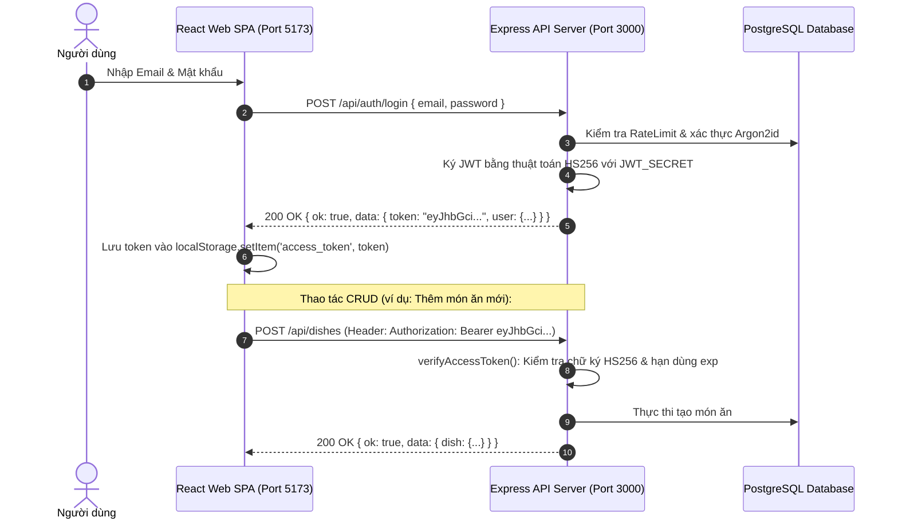

# CẨM NANG TOÀN DIỆN: LÝ THUYẾT, CẤU HÌNH & THUẬT TOÁN BÀI 1 (CSR)

> **Môn học:** Lập Trình Web 2 — Block 9  
> **Đề tài:** **Bài 1: Xác thực tài khoản cho ứng dụng Nhà hàng kiến trúc CSR (Client-Side Rendering)**  
> **Kiến trúc hệ thống:** Tách biệt 2 Origin độc lập:
> - **Backend API:** Node.js + Express (`http://localhost:3000`) — Phi trạng thái (Stateless), trả dữ liệu JSON Envelope.
> - **Frontend Web:** React 18 + Vite SPA (`http://localhost:5173`) — Single Page Application, định tuyến bằng React Router DOM v6.
> - **Cơ sở dữ liệu:** PostgreSQL (Supabase) + Prisma ORM.

---

## MỤC LỤC TỔNG QUAN

1. [Bản Chất Kiến Trúc CSR: Session vs JWT Bearer Token](#1-bản-chất-kiến-trúc-csr-session-vs-jwt-bearer-token)
2. [Toàn Bộ Các Thuật Toán Mật Mã & Chữ Ký Số (Algorithms Deep-Dive)](#2-toàn-bộ-các-thuật-toán-mật-mã--chữ-ký-số)
3. [Bảng Cấu Hình RateLimit & Chống Tấn Công Brute-Force](#3-bảng-cấu-hình-ratelimit--chống-tấn-công-brute-force)
4. [Cơ Chế CAPTCHA Chống Bot Trong CSR](#4-cơ-chế-captcha-chống-bot-trong-csr)
5. [Cấu Hình CORS & Xử Lý Preflight OPTIONS](#5-cấu-hình-cors--xử-lý-preflight-options)
6. [Hợp Đồng Phản Hồi Dữ Liệu (JSON Envelope Contracts) & Mã Lỗi HTTP](#6-hợp-đồng-phản-hồi-dữ-liệu-json-envelope-contracts--mã-lỗi-http)
7. [Luồng Xác Thực & Route Guard Phía React Web SPA](#7-luồng-xác-thực--route-guard-phía-react-web-spa)
8. [Bộ Câu Hỏi Vấn Đáp Chuyên Sâu Cho Bài 1 (CSR)](#8-bộ-câu-hỏi-vấn-đáp-chuyên-sâu-cho-bài-1-csr)

---

## 1. BẢN CHẤT KIẾN TRÚC CSR: SESSION VS JWT BEARER TOKEN

### 1.1 Bài 1 CSR có dùng Session Cookie không?
**KHÔNG DÙNG SESSION COOKIE! HỆ THỐNG DÙNG JWT BEARER TOKEN!**

Trong kiến trúc CSR (Client-Side Rendering), Backend và Frontend chạy ở hai cổng/domain khác nhau (Cross-Origin: `localhost:3000` và `localhost:5173`):
* **Không lưu trạng thái phiên ở Server (Stateless API):** Server không tạo bảng session trong RAM hay tra cứu session ID mỗi request.
* **Chứng thực qua Token:** Khi đăng nhập thành công, server cấp phát một chuỗi **JWT (JSON Web Token)**.
* **Lưu trữ ở Client:** React SPA lưu token vào `localStorage` dưới khóa `access_token`.
* **Gửi dữ liệu:** Mọi request cần quyền hạn đều được JavaScript chủ động gắn vào HTTP Header chuẩn:  
  `Authorization: Bearer <access_token>`



### 1.2 Bài 1 CSR có dùng TOTP (Google Authenticator) không?
**KHÔNG CÓ TOTP! HỆ THỐNG DÙNG EMAIL OTP ĐỂ KÍCH HOẠT TÀI KHOẢN!**
* **Không dùng TOTP (RFC 6238):** Dự án không yêu cầu người dùng quét mã QR vào app điện thoại hay đổi mã mỗi 30 giây.
* **Dùng Email OTP:** Khi đăng ký, server sinh mã ngẫu nhiên 6 chữ số (`crypto.randomInt`), băm bảo vệ bằng **`HMAC-SHA256`** và gửi qua hòm thư điện tử bằng **Nodemailer**. Người dùng nhập mã này vào trang `/activate` để mở khóa tài khoản (`status: pending` $\rightarrow$ `status: active`).

---

## 2. TOÀN BỘ CÁC THUẬT TOÁN MẬT MÃ & CHỮ KÝ SỐ

Hệ thống triển khai chuẩn mực các thuật toán mật mã hiện đại trong tệp [`api/src/services/crypto.js`](file:///d:/III_HK1/Web2/Block%208-9/Block9/api/src/services/crypto.js) và [`api/src/services/jwt.js`](file:///d:/III_HK1/Web2/Block%208-9/Block9/api/src/services/jwt.js):

### 2.1 Thuật toán sinh chữ ký Access Token: HMAC-SHA256 (`HS256`)
* **Thư viện:** `jsonwebtoken` v9.0.2.
* **Công thức tạo chữ ký Token:**
  $$\text{Signature} = \text{HMAC-SHA256}\Big(\text{base64Url}(\text{Header}) + \text{"."} + \text{base64Url}(\text{Payload}),\ \text{JWT\_SECRET}\Big)$$
* **Cấu trúc Payload (Claims):**
  - `sub`: UUID định danh người dùng (`user.id`).
  - `email`: Email đã chuẩn hóa.
  - `role`: Vai trò (`viewer`, `editor`, `admin`).
  - `chefId`: ID đầu bếp liên kết (nếu có).
  - `iss`: `"restaurant-api"`.
  - `exp`: Thời hạn 2 giờ (`2h`).
* **Quy tắc an ninh bắt buộc (Hardcoded Algorithm):**  
  Khi verify token tại middleware, backend **luôn ghim cứng `algorithms: ["HS256"]`**:
  ```javascript
  jwt.verify(token, JWT_SECRET, { algorithms: ["HS256"], issuer: "restaurant-api" });
  ```
  $\implies$ **Triệt tiêu hoàn toàn lỗ hổng Algorithm Confusion Attack** (như tấn công `alg: none` hoặc tráo public-key RSA).
* **Độ dài Secret:** `JWT_SECRET` bắt buộc $\ge 32$ ký tự ngẫu nhiên ($\ge 256\text{ bit}$ entropy) trong `.env`.

### 2.2 Thuật toán băm mật khẩu: Argon2id
* **Thư viện:** `argon2` v0.45.2.
* **Biến thể sử dụng:** `argon2.argon2id` (kết hợp khả năng kháng tấn công phần cứng GPU/ASIC của Argon2d và chống tấn công kênh phụ thời gian của Argon2i).
* **Tham số cấu hình an ninh:**
  - `memoryCost: 65536` ($64\text{ MB RAM}$).
  - `timeCost: 3` (3 vòng lặp thời gian).
  - `parallelism: 1` (1 luồng xử lý).
* **Quy chuẩn mật khẩu:** Độ dài từ 8 đến 128 ký tự, bắt buộc chứa ít nhất 1 chữ cái và 1 chữ số (`/\p{L}/u` và `/\p{N}/u`).

### 2.3 Kỹ thuật chống dò quét Email: Dummy Hash Verification
* **Vấn đề an ninh:** Nếu người dùng nhập email không có trong DB, nếu server trả về lỗi ngay trong 5 ms, kẻ tấn công đo thời gian phản hồi (response time) sẽ biết được email nào đã đăng ký.
* **Giải pháp:** Khi email không tồn tại, server vẫn thực hiện một phép tính verify với mật khẩu giả lập:  
  `argon2.verify(DUMMY_HASH, password)`  
  $\implies$ Thời gian phản hồi luôn giữ cố định ở mức **~1.200 ms**, ngăn chặn triệt để tấn công **User Enumeration qua Timing Attack**.

### 2.4 Thuật toán sinh mã kích hoạt OTP & Pepper
* **Thuật toán sinh:** `String(crypto.randomInt(0, 1000000)).padStart(6, "0")` $\rightarrow$ Sinh số ngẫu nhiên 6 chữ số an toàn mật mã (CSPRNG).
* **Thuật toán băm lưu trữ:** **`HMAC-SHA256`** với khóa bí mật riêng (`OTP_PEPPER`):
  $$\text{otpHash} = \text{crypto.createHmac}("sha256", \text{OTP\_PEPPER}).\text{update}(\text{userId} + ":" + \text{otp}).\text{digest}("hex")$$
  - Không lưu mã gốc vào database.
  - Hạn dùng 10 phút. So khớp chuỗi bằng `crypto.timingSafeEqual`.

### 2.5 Thuật toán Token đặt lại mật khẩu (Password Reset Token)
* **Thuật toán sinh:** `crypto.randomBytes(32).toString("base64url")` $\rightarrow$ 256-bit entropy ngẫu nhiên dạng URL-safe.
* **Cơ chế Hash-at-Rest:**
  - Token gốc gửi trong link email: `http://localhost:5173/reset-password?token=...`
  - Server băm **`SHA-256`** trước khi lưu vào bảng `PasswordReset`:  
    `tokenHash = crypto.createHash("sha256").update(token).digest("hex")`
  - Hạn dùng 15 phút, dùng đúng 1 lần (`usedAt`).

---

## 3. BẢNG CẤU HÌNH RATELIMIT & CHỐNG TẤN CÔNG BRUTE-FORCE

Toàn bộ thông số bảo vệ được lưu trữ bền vững tại bảng `RateLimit` trong Database (restart server bộ đếm không bị xóa):

| Endpoint API | Phương thức | Khóa nhận diện (Key) | Ngưỡng cho phép | Cửa sổ đếm | Thời gian khóa / chờ | Phản hồi khi vi phạm |
| :--- | :---: | :--- | :--- | :--- | :--- | :--- |
| `/api/auth/login` | `POST` | `login:email:<email>` | **10 lần sai** liên tiếp | **15 phút** | **Khóa 5 phút** | HTTP **`429 Too Many Requests`**<br>`code: "RATE_LIMITED"` |
| `/api/auth/login` (CAPTCHA) | `POST` | `login:email:<email>` | **Từ 3 lần sai** | **15 phút** | Đến khi login đúng | Yêu cầu kèm trường `captcha` và `challengeId`. |
| `/api/auth/login` (IP) | `POST` | `login:ip:<ip>` | **30 requests** | **15 phút** | Khóa 15 phút | HTTP `429`, chặn dò mật khẩu nhiều tài khoản từ 1 IP. |
| `/api/auth/register` | `POST` | `register:ip:<ip>` | **10 tài khoản** | **60 phút** | Hết 1 giờ | HTTP `429`, chống bot spam tạo tài khoản rác. |
| `/api/auth/captcha` | `GET` | `captcha:ip:<ip>` | **60 lần** | **15 phút** | Hết 15 phút | HTTP `429`, chống spam tải lại ảnh SVG làm nghẽn CPU. |
| `/api/auth/activate` | `POST` | `activate:user:<userId>` | **5 lần sai OTP** | 10 phút | **Khóa 15 phút** | Khóa phiên kích hoạt; mã bị đóng băng tạm thời. |
| `/api/auth/activate/resend` | `POST` | `resend:user:<userId>` | Tối đa **5 lần / giờ** | 60 phút | **Chờ 60 giây** giữa 2 lần | Chặn spam gửi email; **không reset số lần đếm sai**. |
| `/api/auth/forgot-password` | `POST` | `forgot:ip:<ip>`<br>`forgot:email:<email>` | **20 req/giờ (IP)**<br>**5 req/giờ (Email)** | 60 phút | Hết 1 giờ | HTTP `429`, bảo vệ quota dịch vụ gửi mail SMTP. |
| `/api/auth/change-password` | `POST` | `change-pwd:user:<userId>` | **5 lần sai mk hiện tại**| 15 phút | **Khóa 5 phút** | HTTP `429`, chống brute-force mật khẩu cũ khi đã có token. |

---

## 4. CƠ CHẾ CAPTCHA CHỐNG BOT TRONG CSR

* **Thư viện:** `svg-captcha` v1.4.0 (sinh chuỗi vector SVG cục bộ, không phụ thuộc Google reCAPTCHA, hoàn toàn không theo dõi người dùng).
* **Đặc tính kỹ thuật:**
  - 5 ký tự ngẫu nhiên, 2 đường kẻ nhiễu (`noise: 2`).
  - Loại trừ các ký tự gây nhầm lẫn: `0, o, O, 1, i, l, I`.
  - Màu nền ấm `#fffdf5` đồng bộ giao diện nhà hàng.
* **Cơ chế xác thực một lần duy nhất (Consume-First):**
  1. Khi client yêu cầu `GET /api/auth/captcha`: Server tạo bản ghi trong bảng `CaptchaChallenge` (`id: UUID`, `answer`, `expiresAt = now + 5 phút`).
  2. Khi client submit form: Server thực thi lệnh SQL:
     ```javascript
     const claimed = await db.captchaChallenge.updateMany({
       where: { id, usedAt: null, expiresAt: { gt: now } },
       data: { usedAt: now }
     });
     ```
  3. **Consume trước khi đối chiếu đáp án:** Kể cả người dùng gõ sai đáp án, mã CAPTCHA đó vẫn bị đánh dấu `usedAt = now`. Nếu kẻ tấn công gửi nhiều request song song với cùng một `challengeId`, chỉ có đúng 1 request được xử lý (`claimed.count === 1`), **triệt tiêu 100% tấn công Replay Attack**.
  4. So khớp đáp án bằng hàm chống Timing Attack: `crypto.timingSafeEqual`.

---

## 5. CẤU HÌNH CORS & XỬ LÝ PREFLIGHT OPTIONS

Vì Frontend SPA chạy ở cổng `5173` gọi API ở cổng `3000`, trình duyệt áp dụng cơ chế **Same-Origin Policy**.

### 5.1 Cấu hình Header CORS tại Express Backend
Tệp triển khai: [`api/src/app.js`](file:///d:/III_HK1/Web2/Block%208-9/Block9/api/src/app.js#L10-L24):
```javascript
const allowedOrigins = ["http://localhost:5173", "http://127.0.0.1:5173"];

app.use((req, res, next) => {
  const origin = req.headers.origin;
  if (allowedOrigins.includes(origin)) {
    res.setHeader("Access-Control-Allow-Origin", origin);
  }
  res.setHeader("Access-Control-Allow-Methods", "GET, POST, PATCH, DELETE, OPTIONS");
  res.setHeader("Access-Control-Allow-Headers", "Content-Type, Authorization");
  res.setHeader("Access-Control-Allow-Credentials", "true");

  // Xử lý Preflight Request (OPTIONS)
  if (req.method === "OPTIONS") {
    return res.sendStatus(204);
  }
  next();
});
```

### 5.2 Tại sao trình duyệt tự gửi HTTP method `OPTIONS`?
Khi React SPA gửi request có header tùy biến `Authorization: Bearer <token>`, đây **không phải là CORS Simple Request**. Trình duyệt bắt buộc phải gửi một gói tin thăm dò trước (**CORS Preflight Request**) với method `OPTIONS` để hỏi máy chủ:
1. *"Máy chủ có cho phép origin `http://localhost:5173` gọi API không?"*
2. *"Máy chủ có chấp nhận header `Authorization` không?"*
3. *"Máy chủ có cho phép method `POST/PATCH/DELETE` không?"*

$\implies$ Server Express bắt được `OPTIONS` sẽ lập tức trả về mã **`204 No Content`** kèm các header CORS cho phép. Khi đó trình duyệt mới chính thức gửi request thật (`POST`, `PATCH`, `DELETE`).

---

## 6. HỢP ĐỒNG PHẢN HỒI DỮ LIỆU (JSON ENVELOPE CONTRACTS) & MÃ LỖI HTTP

Mọi endpoint API trong Bài 1 đều tuân thủ chặt chẽ định dạng bao đóng (Envelope Response) chuẩn JSON:

### 6.1 Cấu trúc phản hồi thành công (HTTP 200 OK)
```json
{
  "ok": true,
  "data": {
    "token": "eyJhbGciOiJIUzI1NiIsInR5cCI6IkpXVCJ9...",
    "user": {
      "id": "c1f7b02e-9d2a-4f51-b8a7-6c23d04e5f1a",
      "email": "chef.an@restaurant.com",
      "role": "editor",
      "chefId": 1
    }
  }
}
```

### 6.2 Cấu trúc phản hồi lỗi nghiệp vụ (HTTP 200 / 400 / 401 / 403 / 429)
```json
{
  "ok": false,
  "error": {
    "code": "VALIDATION_FAILED",
    "message": "Dữ liệu gửi lên không hợp lệ.",
    "fields": {
      "price": "Giá món ăn phải là số nguyên dương lớn hơn 0."
    }
  }
}
```

### 6.3 Phân định chuẩn xác các mã trạng thái HTTP

| Mã HTTP | Tên chuẩn | Khi nào API trả về mã này? | Mã lỗi nội bộ (`error.code`) |
| :---: | :--- | :--- | :--- |
| **`200`** | `OK` | - Lấy dữ liệu thành công (`GET`).<br>- Lỗi nhập liệu/sai password do user gõ sai (`ok: false`). | `INVALID_CREDENTIALS`<br>`ACCOUNT_NOT_ACTIVATED` |
| **`204`** | `No Content` | Phản hồi thành công cho Preflight CORS `OPTIONS`. | *(Không có body)* |
| **`400`** | `Bad Request` | Thiếu trường bắt buộc, dữ liệu sai định dạng JSON. | `VALIDATION_FAILED`<br>`INVALID_TOKEN` |
| **`401`** | `Unauthorized` | **Lỗi xác thực danh tính:**<br>- Không gửi kèm Bearer token.<br>- Token bị sai format hoặc sai chữ ký.<br>- Token đã hết hạn `exp`. | `UNAUTHORIZED`<br>`MALFORMED_TOKEN`<br>`TOKEN_EXPIRED` |
| **`403`** | `Forbidden` | **Lỗi phân quyền:**<br>- Viewer cố tình gọi `POST /api/dishes` tạo món.<br>- Editor sửa món của đầu bếp khác hoặc món đã `published`. | `FORBIDDEN` |
| **`404`** | `Not Found` | Gọi sai URL route (Server Express trả 404 kỹ thuật, **không có trường `ok`**). | *(Không có body chuẩn)* |
| **`429`** | `Too Many Requests`| Bị khóa do vượt quá số lần thử sai (Rate Limit / Brute-force). | `RATE_LIMITED` |

---

## 7. LUỒNG XÁC THỰC & ROUTE GUARD PHÍA REACT WEB SPA

### 7.1 Lớp giao tiếp mạng tập trung (`web/src/apiClient.js`)
* **Tự động gắn Token:** Đọc `access_token` từ `localStorage` và tự động đính kèm vào header:
  ```javascript
  const token = localStorage.getItem("access_token");
  if (token) {
    headers["Authorization"] = `Bearer ${token}`;
  }
  ```
* **Bắt lỗi 401 tập trung (Global 401 Interceptor):** Khi nhận được HTTP `401 Unauthorized` từ bất kỳ API nào, client tự động:
  1. Xóa bỏ token hỏng/hết hạn: `localStorage.removeItem("access_token")`.
  2. Phát sự kiện `auth:unauthorized` để React Context xóa `user` và điều hướng người dùng về trang `/login`.

### 7.2 Quản lý phiên qua `AuthContext.jsx`
* Cung cấp các state toàn cục: `user`, `token`, `isAuthenticated`, `isLoading`.
* Khi tải lại trang (F5): Gọi API `GET /api/auth/me` để nạp lại thông tin người dùng từ server mà không bắt đăng nhập lại.

### 7.3 Bảo vệ trang quản trị qua `ProtectedRoute.jsx` (Route Guard)
```jsx
export default function ProtectedRoute({ children, allowedRoles }) {
  const { user, isAuthenticated, isLoading } = useAuth();

  if (isLoading) return <LoadingSkeleton />;
  if (!isAuthenticated) return <Navigate to="/login" replace />;
  if (allowedRoles && !allowedRoles.includes(user.role)) {
    return <Navigate to="/" replace />;
  }
  return children;
}
```

---

## 8. BỘ CÂU HỎI VẤN ĐÁP CHUYÊN SÂU CHO BÀI 1 (CSR)

### Câu 1: Tại sao Bài 1 dùng JWT Bearer Token mà không dùng Session-Cookie?
**Trả lời:**  
*"Dạ vì Bài 1 xây dựng theo kiến trúc Client-Side Rendering (CSR), tách biệt hoàn toàn giữa Frontend React SPA (port 5173) và Backend Express API (port 3000).  
- Sử dụng Session-Cookie gặp rào cản Cross-Origin và nguy cơ tấn công CSRF.  
- JWT Bearer Token giúp API hoàn toàn **phi trạng thái (Stateless)**, server không tốn bộ nhớ lưu bảng phiên, dễ dàng mở rộng quy mô (Horizontal Scaling) và phù hợp cho cả ứng dụng Web SPA lẫn Mobile App sau này."*

### Câu 2: Chữ ký JWT trong bài được sinh bằng thuật toán nào? Tại sao phải ghim cố định thuật toán khi verify?
**Trả lời:**  
*"Dạ chữ ký token được ký bằng thuật toán đối xứng **`HS256` (HMAC với SHA-256)** sử dụng khóa bí mật `JWT_SECRET` có độ dài trên 32 ký tự.  
Khi verify ở middleware `authenticateToken`, em **ghim cứng `algorithms: ["HS256"]`** để phòng ngừa lỗ hổng **Algorithm Confusion Attack** — nếu kẻ tấn công sửa header token thành `alg: "none"` hoặc chuyển sang bất đối xứng, thư viện sẽ từ chối ngay lập tức mà không chấp nhận token giả mạo."*

### Câu 3: Làm thế nào để phân biệt giữa mã lỗi 401 và 403 trong API?
**Trả lời:**  
*- **Mã 401 Unauthorized:** Là lỗi **Xác thực danh tính (Authentication)** — Server chưa biết bạn là ai (không có Bearer token, token sai chữ ký, hoặc token hết hạn `exp`). Khi gặp 401, React SPA sẽ xóa token và điều hướng về trang `/login`.  
- **Mã 403 Forbidden:** Là lỗi **Phân quyền (Authorization)** — Server đã xác thực được bạn là ai qua token, nhưng bạn **không có quyền** thực hiện hành động này (ví dụ: Viewer gọi API xóa món ăn, Editor sửa món của đầu bếp khác). Khi gặp 403, React SPA giữ nguyên phiên đăng nhập và hiển thị thông báo lỗi."*

### Câu 4: Trình bày cơ chế chống Brute-force khi đăng nhập trong bài?
**Trả lời:**  
*"Dạ hệ thống lưu trữ bộ đếm thử sai trong bảng `RateLimit` tại Database theo cả IP và Email:  
1. Nếu thử sai **dưới 3 lần**: Đăng nhập bình thường.  
2. Nếu thử sai **từ 3 lần trở lên**: Backend bắt buộc phải có CAPTCHA vector mới cho phép kiểm tra mật khẩu.  
3. Nếu thử sai **đủ 10 lần liên tiếp**: Backend khóa tài khoản tạm thời trong vòng **5 phút** (`lockedUntil`), trả về HTTP `429 Too Many Requests`.  
4. Ngoài ra, nếu email không tồn tại trong DB, server vẫn chạy hàm verify với hash giả lập (`DUMMY_HASH`) để thời gian phản hồi luôn đồng đều ~1.200 ms, chống dò quét tài khoản qua thời gian (Timing Attack)."*

### Câu 5: Tại sao trình duyệt lại gửi request `OPTIONS` trước khi gọi API `POST/PATCH/DELETE`?
**Trả lời:**  
*"Dạ vì request từ React SPA sang API có đính kèm header tùy biến `Authorization: Bearer <token>`, không phải là CORS Simple Request. Trình duyệt bắt buộc phải gửi một gói tin thăm dò **CORS Preflight (HTTP OPTIONS)** trước để hỏi server có chấp thuận Origin `http://localhost:5173` và header `Authorization` hay không. Server của em bắt `OPTIONS` và phản hồi mã **`204 No Content`** kèm các header `Access-Control-Allow-*`, sau đó trình duyệt mới cho phép gửi request chính thức."*
