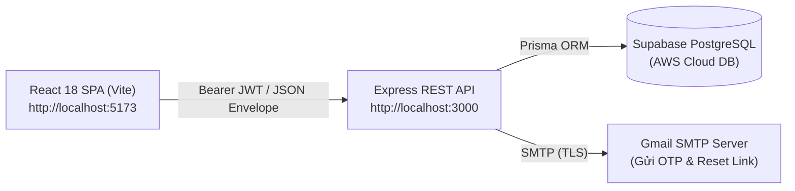

# Restaurant App — Hệ Thống Thực Đơn & Xác Thực Kiến Trúc CSR (Block 9)

> **Dự án Lập Trình Web 2 — Block 9 (Bài 1: Xác thực & Quản trị cho ứng dụng Single Page Application)**  
> Ứng dụng Thực Đơn & Quản trị Nhà Hàng được xây dựng theo kiến trúc **Client-Side Rendering (CSR)** tách biệt hoàn toàn giữa Backend RESTful API và Frontend React 18 SPA, kế thừa nền tảng quản trị từ Block 7 và hệ thống bảo mật an ninh mật mã từ Block 8.

---

## 1. Tổng Quan Kiến Trúc & Technical Stack

Hệ thống hoạt động theo mô hình Cross-Origin phân tách độc lập:
* **Backend REST API (`/api`):** Chạy tại cổng `http://localhost:3000` (Node.js Express + Prisma ORM + Supabase PostgreSQL).
* **Frontend Web SPA (`/web`):** Chạy tại cổng `http://localhost:5173` (React 18 + Vite 5 + React Router v6).



### Công nghệ & Thư viện sử dụng

| Tầng hệ thống | Công nghệ / Thư viện | Vai trò kỹ thuật |
| :--- | :--- | :--- |
| **Backend Framework** | Node.js + Express 4 | Cung cấp RESTful API phi trạng thái (Stateless), trả dữ liệu theo chuẩn JSON Envelope `{ ok: true, data }` hoặc `{ ok: false, error }`. |
| **Cơ sở dữ liệu** | PostgreSQL (Supabase) + Prisma | Lưu trữ dữ liệu món ăn, đầu bếp, người dùng, challenge kích hoạt và rate limits; truy vấn an toàn bằng Parameterized Query và Serializable Transaction. |
| **Băm mật khẩu** | `argon2` (Argon2id) | Thuật toán băm mật khẩu chuẩn hàng đầu thế giới, chống tấn công brute-force GPU/ASIC và Side-Channel Timing Attack. |
| **Chứng thực danh tính** | `jsonwebtoken` (JWT) | Cấp phát Bearer Access Token ký bằng thuật toán `HS256` với thời hạn 2 giờ (`2h`). |
| **Mã bảo vệ** | `svg-captcha` | Tạo ảnh vector SVG mã xác thực 5 ký tự chống bot và chống spam brute-force đăng nhập. |
| **Dịch vụ Email OTP** | `nodemailer` | Gửi mã OTP kích hoạt tài khoản và liên kết đặt lại mật khẩu qua máy chủ SMTP Gmail. |
| **Frontend Web SPA** | React 18 + Vite 5 | SPA tối ưu hiệu năng cao, định tuyến client-side bằng `react-router-dom` v6, bảo vệ màn hình qua `ProtectedRoute`. |
| **Bộ Icon UI** | `lucide-react` | Cung cấp icon vector trực quan (con mắt ẩn/hiện mật khẩu, khóa, chìa khóa, người dùng, thìa dĩa...). |

---

## 2. Các Tính Năng Nổi Bật

### 2.1. Phía Khách Hàng (Public Client)
* **Thực đơn món ăn (`/dishes`):** Danh sách món ăn bố trí theo Grid responsive sang trọng, hỗ trợ phân trang (`page`, `limit`), lọc theo danh mục (Khai vị, Món chính, Tráng miệng, Đồ uống), tìm kiếm theo tên món và mô tả.
* **Chi tiết món ăn (`/dishes/:id`):** Xem thông tin nguyên liệu, đầu bếp phụ trách, giá bán, thời gian chuẩn bị và trạng thái phục vụ.

### 2.2. Hệ Thống Xác Thực & Bảo Mật (Authentication)
* **Đăng ký tài khoản (`/register`):**
  * Bắt buộc giải mã bảo vệ **SVG CAPTCHA**.
  * Ràng buộc mật khẩu an toàn: độ dài từ 8–128 ký tự, bao gồm cả chữ cái và chữ số.
  * Tích hợp biểu tượng **Con mắt** bật/tắt hiển thị mật khẩu trực quan.
  * Băm mật khẩu bằng thuật toán **Argon2id** trước khi lưu vào DB.
* **Kích hoạt tài khoản (`/activate`):**
  * Mã OTP 6 chữ số được gửi tự động đến hộp thư email của người dùng (đồng thời log trực tiếp lên console backend trong môi trường Dev).
  * Ô email được **cố định (`readOnly`)** tự động từ bước đăng ký, chống chỉnh sửa nhầm.
  * Giới hạn thời gian gửi lại mã OTP (**Cooldown 60 giây**) có đồng hồ đếm ngược.
* **Đăng nhập (`/login`):**
  * Cấp phát Bearer JWT Token không trạng thái lưu tại `localStorage`.
  * Cơ chế phòng thủ **Brute-Force:** Tự động kích hoạt khối xác nhận CAPTCHA nếu đăng nhập sai từ 3 lần trở lên; tự động khóa tạm thời 5 phút nếu vượt quá ngưỡng thử sai.
* **Khôi phục phiên làm việc:**
  * Khi người dùng tải lại trang (F5), Frontend tự động gửi `GET /api/auth/me` kèm token để phục hồi phiên đăng nhập mà không bắt đăng nhập lại.
* **Quên mật khẩu (`/forgot-password`) & Đặt lại mật khẩu từ liên kết (`/reset-password`):**
  * Gửi token bí mật URL-safe 32 bytes qua email với thời hạn 15 phút.
* **Đổi / Đặt lại mật khẩu khi đã đăng nhập (`/change-password`):**
  * Cho phép người dùng đã đăng nhập đổi mật khẩu mới.
  * **Cơ chế chống Brute-Force đa tầng:** Áp dụng bộ đếm thử sai trên tài khoản; nếu nhập sai mật khẩu hiện tại 5 lần liên tiếp sẽ tự động khóa tạm thời chức năng trong 5 phút (`ACCOUNT_LOCKED`).
  * **Thứ tự kiểm tra nghiêm ngặt:** Luôn xác thực tính chính xác của mật khẩu hiện tại bằng **Argon2id** trước; chỉ khi mật khẩu hiện tại đã đúng thì hệ thống mới kiểm tra xem mật khẩu mới có bị trùng với mật khẩu cũ hay không.
  * Tích hợp biểu tượng con mắt bật/tắt xem mật khẩu cho cả 3 trường nhập.
* **Menu tài khoản người dùng trực quan trên Navbar:**
  * Khi đăng nhập thành công, Navbar hiển thị nút Tài khoản gọn gàng (`user@email.com ▼`).
  * Nhấp vào nút sẽ mở Dropdown menu tối giản và tập trung với 2 tùy chọn thiết yếu: **"Đặt lại mật khẩu"** và **"Đăng xuất"** (đã tinh giản, loại bỏ các mục điều hướng trùng lặp đã có sẵn trên thanh Navbar chính).

### 2.3. Cổng Quản Trị Hệ Thống (`/admin/*`)
* **Route Guard (`ProtectedRoute`):** Tự động chặn người dùng chưa đăng nhập truy cập vào bất kỳ route quản trị nào và điều hướng về `/login`.
* **Quản trị Món ăn (`/admin/dishes`):** Thêm mới món ăn (`/new`), chỉnh sửa món (`/:id/edit`), xóa món ăn.
* **Quản trị Đầu bếp (`/admin/chefs`):** Quản lý danh sách bếp trưởng, chuyên môn ẩm thực và năm kinh nghiệm.
* **Quản trị Nguyên liệu (`/admin/ingredients`):** Quản lý kho nguyên vật liệu và đơn vị tính.
* Toàn bộ thao tác ghi (`POST`, `PATCH`, `DELETE`) trên API đều được kiểm soát bởi middleware `authenticateToken`.

---

## 3. Cấu Trúc Thư Mục Dự Án

```text
Block9/
├── api/                             # MÁY CHỦ BACKEND (EXPRESS REST API)
│   ├── prisma/
│   │   └── schema.prisma            # Schema định nghĩa các bảng DB (User, Dishes, Chefs...)
│   ├── src/
│   │   ├── config/                  # Chính sách bảo mật (authPolicy.js)
│   │   ├── middleware/              # authenticateToken.js (Kiểm tra Bearer JWT)
│   │   ├── routes/                  # auth.js, dishes.js, chefs.js, ingredients.js
│   │   ├── services/                # crypto.js, jwt.js, captcha.js, otp.js, mail.js...
│   │   ├── app.js                   # Cấu hình Express app và CORS
│   │   └── server.js                # Điểm khởi động máy chủ API
│   ├── tests/                       # Test suites tự động (auth.test.js, api.test.js)
│   ├── .env                         # Biến môi trường Backend
│   └── package.json
│
├── web/                             # GIAO DIỆN CLIENT (REACT 18 VITE SPA)
│   ├── src/
│   │   ├── components/              # Navbar.jsx, ProtectedRoute.jsx, Footer.jsx...
│   │   ├── context/                 # AuthContext.jsx, useAuth.js
│   │   ├── views/
│   │   │   ├── auth/                # Login, Register, Activate, ChangePassword...
│   │   │   ├── admin/               # Admin CRUD cho Dishes, Chefs, Ingredients
│   │   │   └── dishes/              # DishList, DishDetail (Public)
│   │   ├── apiClient.js             # Lớp gọi API tập trung xử lý Token và CORS
│   │   ├── App.jsx                  # Định tuyến toàn cục (React Router v6)
│   │   └── main.jsx
│   ├── public/                      # Tài nguyên tĩnh CSS, ảnh và font
│   ├── tests/                       # Unit tests phía Client
│   └── package.json
│
├── assets/                          # Tài nguyên thiết kế & ảnh
├── BAO_CAO_XAC_THUC_CSR_BLOCK9.md   # Báo cáo chuyên sâu kiến trúc xác thực & mật mã Bài 1
└── README.md                        # Hướng dẫn này
```

---

## 4. Hướng Dẫn Cài Đặt & Khởi Động

### Điều kiện tiên quyết:
* Đã cài đặt **Node.js** phiên bản `>= 18.x` (khuyến nghị Node 20.x hoặc 22.x/24.x).
* Trình quản lý gói **npm**.

---

### Bước 1: Cài đặt Dependencies

Mở terminal (PowerShell hoặc Command Prompt) tại thư mục `Block9`:

```powershell
# 1. Cài đặt thư viện cho Backend API
cd "Block9\api"
npm install

# 2. Cài đặt thư viện cho Frontend Web SPA
cd "Block9\web"
npm install
```

---

### Bước 2: Cấu hình Biến Môi Trường (`.env`)

File `Block9/api/.env` đã được cấu hình đầy đủ kết nối tới cơ sở dữ liệu Supabase và dịch vụ gửi mail Gmail.

---

### Bước 3: Khởi động Ứng Dụng

Mở 2 cửa sổ terminal riêng biệt để chạy đồng thời Backend và Frontend:

#### Terminal 1 — Chạy Backend REST API:
```powershell
cd "Block9\api"
npm run dev
```
> Server API khởi động tại: **`http://localhost:3000`**

#### Terminal 2 — Chạy Frontend Web SPA:
```powershell
cd "Block9\web"
npm run dev
```
> Ứng dụng Web mở tại: **`http://localhost:5173`**

---

## 5. Tài Khoản Kiểm Thử Có Sẵn

Bạn có thể đăng nhập ngay bằng một trong các tài khoản thử nghiệm sau:

| Email | Mật khẩu | Quyền hạn |
| :--- | :--- | :--- |
| `editora@example.test` | `Local83ibxe045EajMyRCvTfk4oZOHnWlfosyN` | Editor (Toàn quyền quản trị) |
| `editorb@example.test` | `Local83ibxe045EajMyRCvTfk4oZOHnWlfosyN` | Editor (Toàn quyền quản trị) |
| `admin@example.test` | `Local83ibxe045EajMyRCvTfk4oZOHnWlfosyN` | Admin (Toàn quyền quản trị) |

Hoặc tự bấm **"Đăng ký"** để tạo tài khoản riêng, nhập mã OTP gửi về email (hoặc xem trực tiếp trên console của Backend) để kích hoạt.

---

## 6. Hướng Dẫn Chạy Kiểm Thử Tự Động (Automated Tests)

Hệ thống đi kèm bộ kiểm thử tự động toàn diện kiểm chứng toàn bộ các tiêu chí xác thực và an ninh:

```powershell
# 1. Chạy toàn bộ 23 Test Cases Backend API (CORS, Món ăn, Đầu bếp, JWT, Auth, Đổi mật khẩu, Brute-force...)
cd "Block9\api"
node --test tests/auth.test.js tests/api.test.js

# 2. Chạy Test Cases Frontend Web SPA
cd "Block9\web"
node --test tests/apiClient.test.js tests/appRoutes.test.js tests/authContext.test.js

# 3. Kiểm tra Đóng gói Bản Build Production (Vite)
cd "Block9\web"
npm run build
```

**Kết quả kiểm thử chuẩn:**
* `api tests`: **23/23 PASS (100%)**
* `web tests`: **2/2 PASS (100%)**
* `vite build`: **1980 modules transformed, 0 error (100% SUCCESS)**.

---
