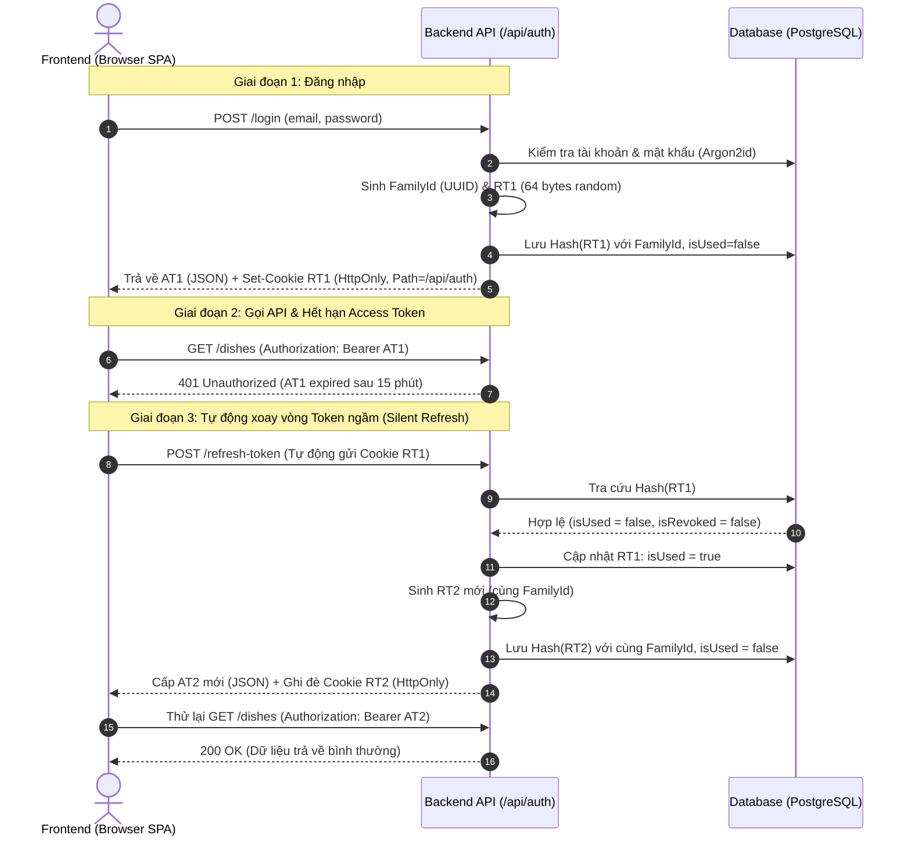
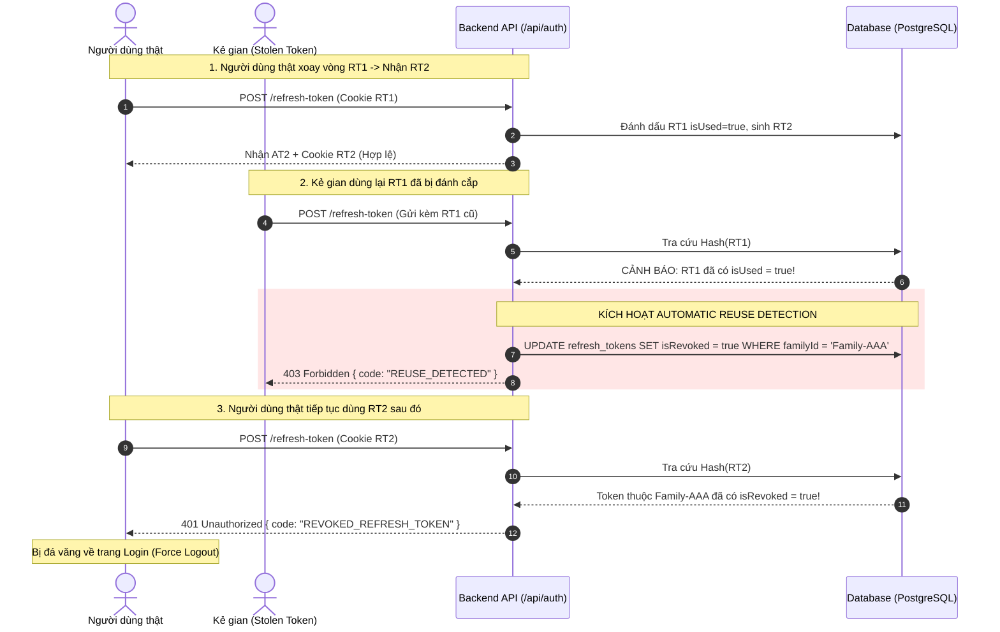

# BÁO CÁO KỸ THUẬT: CƠ CHẾ REFRESH TOKEN ROTATION VÀ REUSE DETECTION

> **Dự án:** Restaurant Management System (Block 9)  
> **Tiêu chuẩn áp dụng:** OAuth 2.0 Security Best Current Practice (RFC 6819 & RFC 6749)  
> **Mô hình kiến trúc:** Refresh Token Rotation (RTR) kết hợp Token Family và Automatic Reuse Detection  

---

## 1. TỔNG QUAN HỆ THỐNG XÁC THỰC

Trước đây, hệ thống chỉ sử dụng **JWT Access Token đơn lẻ** với thời hạn dài (2 giờ) lưu tại `localStorage`. Mô hình này tiềm ẩn các nguy cơ:
- Nếu thiết bị dính mã độc XSS, Access Token có thể bị đánh cắp và kẻ tấn công có quyền truy cập suốt 2 giờ mà server **không thể thu hồi** (Stateless).
- Nếu giảm thời hạn Access Token xuống quá ngắn (15 phút) mà không có Refresh Token, người dùng sẽ liên tục bị văng ra ngoài đăng nhập lại.

**Giải pháp nâng cấp tại Block 9:**
Triển khai cơ chế **Refresh Token Rotation (RTR)** kết hợp **Token Family**:
- **Access Token:** JWT sống ngắn (**15 phút**), lưu tạm trong bộ nhớ/LocalStorage.
- **Refresh Token:** Chuỗi ngẫu nhiên Opaque (512-bit), sống **7 ngày**, lưu trong **HttpOnly Cookie** (JavaScript không thể đọc được).
- **Cơ chế xoay vòng (Rotation):** Mỗi lần đổi Access Token mới, Refresh Token cũ sẽ bị hủy ngay lập tức và cấp 1 Refresh Token mới toanh.
- **Phát hiện dùng trùng (Reuse Detection):** Nếu một Refresh Token cũ (đã dùng) xuất hiện lại, Server lập tức kết luận phiên làm việc đã bị rò rỉ và **hủy toàn bộ chuỗi token (Token Family)** của thiết bị đó.

---

## 2. BÁO CÁO CHI TIẾT 2 LUỒNG HOẠT ĐỘNG

### Luồng 1: Hoạt động bình thường (Happy Path - Token Rotation)

Luồng xoay vòng token diễn ra ngầm (silent refresh) mà người dùng không hề hay biết, mang lại trải nghiệm liền mạch (Seamless UX).



#### Trạng thái Database trong Luồng 1:
| ID Token | Family ID | Hash(Token) | Trạng thái `isUsed` | Trạng thái `isRevoked` | Ghi chú |
| :--- | :--- | :--- | :---: | :---: | :--- |
| `RT_1` | `Family-AAA` | `a1b2...` | **`true`** | `false` | Đã xoay vòng thành công |
| `RT_2` | `Family-AAA` | `c3d4...` | **`false`** | `false` | Đang hoạt động hợp lệ |

---

### Luồng 2: Phát hiện dùng trùng / Kẻ gian tấn công (Reuse Detection)

Kịch bản: Kẻ gian đánh cắp được `RT_1` (ví dụ thông qua mạng nội bộ không bảo mật hoặc snapshot cookie trước đó).



#### Trạng thái Database sau khi kích hoạt Reuse Detection:
| ID Token | Family ID | Hash(Token) | Trạng thái `isUsed` | Trạng thái `isRevoked` | Kết quả |
| :--- | :--- | :--- | :---: | :---: | :--- |
| `RT_1` | `Family-AAA` | `a1b2...` | `true` | **`true`** | Kẻ gian dùng lại $\rightarrow$ Bị chặn 403 |
| `RT_2` | `Family-AAA` | `c3d4...` | `false` | **`true`** | Bị thu hồi toàn chuỗi $\rightarrow$ Bị chặn 401 |

> **Giá trị bảo mật cốt lõi:** Kẻ gian **không thể** sinh thêm bất kỳ Access Token nào mới. Tài khoản của nạn nhân lập tức được cách ly, buộc phải đăng nhập lại bằng mật khẩu + OTP/MFA.

---

## 3. TECHNICAL STACKS & CÁC THUẬT TOÁN ĐÃ SỬ DỤNG

### 1. Thuật toán sinh Token (CSPRNG)
- **Phương pháp:** Sử dụng `crypto.randomBytes(64)` từ thư viện chuẩn Node.js.
- **Độ an toàn:** Cung cấp độ dài 512-bit entropy ngẫu nhiên cao, chống tấn công suy đoán hoặc va chạm chuỗi (Brute-force / Birthday attack).

### 2. Thuật toán băm lưu trữ Token (SHA-256)
- **Phương pháp:** Refresh Token không bao giờ được lưu dạng thô (plaintext) trong Database. Toàn bộ được băm bằng SHA-256 trước khi lưu hoặc tra cứu:
  $$\text{StoredHash} = \text{SHA256}(\text{RawToken})$$
- **Lợi ích:** Ngay cả khi Database bị lộ (SQL Injection, rò rỉ backup), kẻ tấn công không thể sử dụng các hash này để gửi lên API.

### 3. JWT Signing Algorithm (HS256)
- Dùng cho Access Token ngắn hạn (15 phút).
- Được ký bằng secret key tối thiểu 32 ký tự (`JWT_SECRET`).
- Payload chứa tối giản: `sub` (User ID), `email`, `role`, `chefId`.

### 4. Phòng thủ Cookie (Defense-in-Depth)
Refresh Token được bảo vệ thông qua Cookie Flag tiêu chuẩn:
- `HttpOnly: true`: Ngăn chặn 100% mã độc Javascript (XSS) đọc trộm token.
- `SameSite: 'Lax'` (hoặc `'Strict'` trên production): Phòng chống tấn công giả mạo yêu cầu (CSRF).
- `Path: '/api/auth'`: Thu hẹp phạm vi gửi cookie; trình duyệt chỉ gửi cookie khi gọi các endpoint xác thực, không gửi tràn lan ở mọi API.
- `Secure: true`: Bắt buộc truyền qua HTTPS trên môi trường Production.

### 5. Frontend Concurrency Queue (Chống Race Condition)
- **Vấn đề thực tế:** Khi người dùng mở trang có 4 API gọi đồng thời (`/dishes`, `/chefs`, `/ingredients`, `/me`) và cả 4 API đều bị 401. Nếu cả 4 cùng gọi `/refresh-token`, các request sau sẽ gửi token cũ vừa bị xoay vòng, dẫn đến kích hoạt nhầm cơ chế Reuse Detection!
- **Giải pháp xử lý:** Triển khai **Request Queue & Subscriber Pattern** trong `apiClient.js`:
  - Request đầu tiên bị 401 sẽ bật cờ `isRefreshing = true`.
  - Các request còn lại bị tạm giữ (queued) dưới dạng các unresolved Promise.
  - Sau khi request đầu tiên nhận được Access Token mới, nó phân phối lại cho toàn bộ hàng đợi và gọi lại (retry) tất cả request cùng lúc.

---

## 4. CẤU HÌNH & HƯỚNG DẪN KIỂM TRA (VERIFICATION)

### Cách 1: Chạy bộ kiểm thử tự động (Automated Test Suite)

Bộ test `tests/refreshToken.test.js` đã được xây dựng sẵn để kiểm chứng toàn bộ các kịch bản:
```bash
# Di chuyển vào thư mục backend
cd Block9/api

# Chạy test suite dành riêng cho Refresh Token
npm run test:rt
```

**Kết quả kiểm thử thực tế đạt được:**
- `✔ RTR 1`: Đăng nhập cấp phát Access Token và Refresh Token 1 trong HttpOnly Cookie.
- `✔ RTR 2 (Happy Path)`: Xoay vòng Refresh Token thành công, DB ghi nhận trạng thái `isUsed = true` cho RT1 và sinh RT2 cùng Family ID.
- `✔ RTR 3 (Reuse Detection)`: Giả lập hacker gửi lại RT1 $\rightarrow$ Hệ thống bắt được, trả về `403 REUSE_DETECTED`, hủy toàn bộ Family token trong DB, và chặn đứng RT3 của người dùng thật.
- `✔ RTR 4`: Đăng xuất (`/logout`) xóa Cookie và thu hồi token trong DB.

### Cách 2: Kiểm tra trực tiếp trên Trình duyệt (Manual UI Testing)

1. Mở trang Web `http://localhost:5173/login`.
2. Mở **Chrome DevTools (F12)** $\rightarrow$ Tab **Application** $\rightarrow$ **Cookies** $\rightarrow$ `http://localhost:3000`:
   - Kiểm tra thấy cookie `refreshToken` có cờ tích xanh ở cột **HttpOnly**.
   - Thử mở Console gõ `document.cookie`: Chuỗi trả về **hoàn toàn không thấy `refreshToken`** (Minh chứng XSS không thể đọc được).
3. Chuyển sang Tab **Network**:
   - Khi hết hạn 15 phút hoặc Access Token bị xóa, thấy API tự động bắn ngầm `POST /api/auth/refresh-token` thành công (200) trước khi gọi lại dữ liệu.
4. Bấm **Đăng xuất (Logout)**:
   - Thấy request `POST /api/auth/logout` được gửi đi.
   - Cookie `refreshToken` lập tức biến mất khỏi DevTools.

---

## 5. TỔNG KẾT FILE CODE ĐÃ TRIỂN KHAI

| File | Vai trò thay đổi |
| :--- | :--- |
| `api/prisma/schema.prisma` | Bổ sung model `RefreshToken` quan hệ 1-N với `User`, hỗ trợ `familyId`, `isUsed`, `isRevoked`. |
| `api/src/services/refreshTokenService.js` | Module độc lập xử lý sinh token, hash SHA-256, xoay vòng, và Reuse Detection. |
| `api/src/services/jwt.js` | Điều chỉnh thời hạn Access Token xuống **15 phút**. |
| `api/src/app.js` | Tích hợp `cookie-parser` và bật `Access-Control-Allow-Credentials: true` cho CORS. |
| `api/src/routes/auth.js` | Bổ sung các endpoint `/refresh-token`, `/logout`, và cập nhật `/login`. |
| `web/src/apiClient.js` | Nâng cấp `fetch` với `credentials: "include"` và cơ chế **Concurrency Request Queue** khi refresh. |
| `web/src/context/AuthContext.jsx` | Cập nhật hàm `logout()` đồng bộ thu hồi session trên server. |
| `api/tests/refreshToken.test.js` | Bộ 4 test case tự động kiểm thử toàn diện Happy Path và Abuse Detection. |
